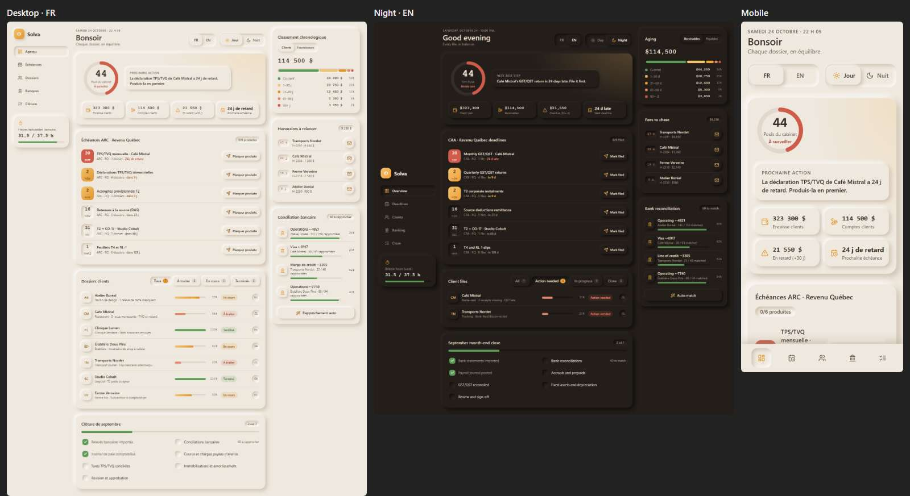

# Solva

Mock dashboard for a small Québec accounting firm (cabinet comptable): CRA / Revenu Québec deadlines,
client files, month-end close, aging, fees to chase, bank reconciliation, and a "Firm Pulse" score.
Bilingual FR-CA / EN-CA, day and night themes. Static HTML/CSS/JS, fake data, nothing is filed or sent.

Deadline dates follow the real rules (15th for source deductions, month after quarter end for GST/QST,
weekends move to the next business day) and are computed from today's date.

Run locally: `python -m http.server 5174` then open http://localhost:5174

Screenshots: `python tools/shots.py http://localhost:5174/` writes `shots/sheet.jpg` (one contact sheet).
Icons: `python tools/vendor_icons.py` vendors the Lucide icons into `assets/icons.js` (no CDN).

